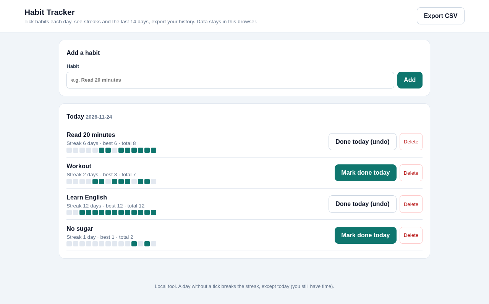

# Habit Tracker

_Screenshot of the tool with sample data entered through the page (fictional names and numbers)._

Tick habits each day, see current and best streaks and the last 14 days, export your history as CSV.

## What it does
- Add and delete habits, duplicate names rejected
- Streak and best streak (today does not break a streak until the day ends)
- 14-day dots per habit
- CSV export
- Data saved in the browser

## Run it
Open `index.html` in a browser. No install, no build, no server, no account.

## Tests and limits
- Browser-tested in headless Chrome: 13 checks passed on the current code (they include a mobile layout check, which only proves nothing overflows).
- Data stays in this browser. Clearing site data deletes it. No sync between devices.
- Plain HTML, CSS and JavaScript, no frameworks.

Built by Mahamed Yasser.
